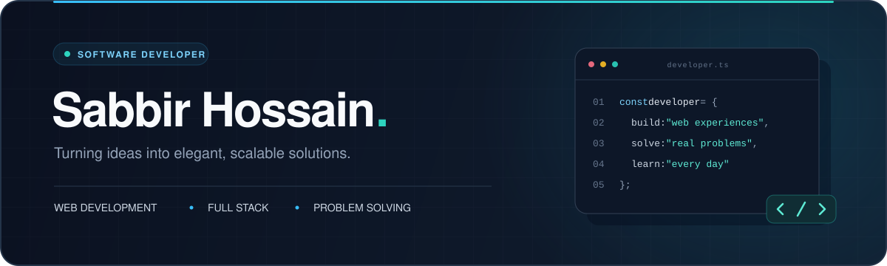

  

# Sabbir Hossain

**Software Developer · Web Developer · Problem Solver**

Turning ideas into elegant, scalable solutions.

[About](#about) · [Tech stack](#tech-stack) · [Learning](#currently-learning) · [Problem solving](#problem-solving) · [Activity](#github-activity)

---

## About

I'm a software developer focused on **web development and full stack applications**. I enjoy building useful products, working through challenging problems, and growing with every project.

- **Build:** clean web interfaces and scalable applications.
- **Solve:** data structures, algorithms, and programming challenges.
- **Grow:** stronger JavaScript skills and a deeper understanding of the React ecosystem.
- **Collaborate:** open to freelance work, collaborations, and exciting opportunities.

## Tech stack

<table>
  <tr>
    <td><strong>Languages</strong></td>
    <td>
       
      JavaScript · Python · C++
    </td>
  </tr>
  <tr>
    <td><strong>Frontend</strong></td>
    <td>
       
      React · Tailwind CSS · DaisyUI · HTML5 · CSS3
    </td>
  </tr>
  <tr>
    <td><strong>Backend &amp; data</strong></td>
    <td>
       
      Node.js · Express · MongoDB · Firebase
    </td>
  </tr>
  <tr>
    <td><strong>Developer tools</strong></td>
    <td>
       
      Git · GitHub · VS Code · Docker · Postman
    </td>
  </tr>
</table>

## Currently learning

| Focus | Direction |
| :--- | :--- |
| **Full stack development** | Connecting frontend experiences with backend services |
| **Advanced JavaScript** | Deepening my understanding of the language |
| **React ecosystem** | Exploring tools and patterns for modern web applications |
| **DSA & problem solving** | Strengthening algorithms, logic, and consistency |

## Problem solving

Solving problems, sharpening logic, and improving every day.

  

## GitHub activity

  

  
<strong>Explore my most-used languages</strong>

   
  

    
  

---

## Let's connect

Have a project in mind or an interesting tech idea? Let's talk about **web development, projects, and growth**.

**[Message me on LinkedIn](https://www.linkedin.com/in/sabbir-hossain-developer)** · [Find me on Facebook](https://www.facebook.com/sabbirhossaindeveloper) · [Explore my repositories](https://github.com/sabbir-hossain-dev?tab=repositories)

   
   
  Build products that matter. Keep learning. Keep shipping.

